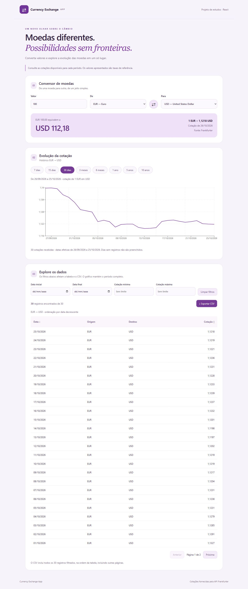

# Currency Exchange App

Aplicação de conversão e análise de moedas, desenvolvida com React e JavaScript para um projeto acadêmico.

## Funcionalidades
- Conversão com taxa e data efetiva da API Frankfurter, seleção e inversão das moedas.
- Histórico de 7, 15 e 30 dias; 3 e 6 meses; 1, 5 e 10 anos.
- Gráfico de linhas e tabela paginada com dados da mesma consulta.
- Filtros combinados por data e cotação, ordenação crescente/decrescente e contador.
- CSV com todos os registros filtrados, preservando a ordem, incluindo outras páginas.
- Validação, carregamento, mensagens de erro com nova tentativa e estado sem dados.

## Tecnologias
React, JSX, Vite, CSS Modules, Recharts, fetch com async/await e testes nativos do Node.js.
O projeto utiliza props, useState, useEffect, lifting state up e o hook useFrankfurter.

## Executar localmente
Requer Node.js compatível com Vite 8 (Node 20.19+, 22.12+ ou versão posterior compatível).
Desenvolvimento realizado com Node 24.

~~~bash
git clone https://github.com/miyamiyashiro/Currency-Exchange-App.git
cd Currency-Exchange-App
npm ci
npm run dev
~~~

Abra o endereço Local mostrado no terminal. No PowerShell, use npm.cmd no lugar de npm
se a execução de npm.ps1 estiver bloqueada. Não é necessária chave de API ou arquivo .env.

## Verificar e gerar a versão de produção
~~~bash
npm run lint
npm test
npm run build
npm run preview
~~~

O build gera a pasta dist. A prévia serve esse build localmente.
A dependência de gráficos gera um aviso de tamanho acima de 500 kB; o build é concluído.

## Como usar
1. Escolha origem, destino e um valor maior que zero.
2. Use a seta para inverter as moedas mantendo o valor digitado.
3. Selecione um período para atualizar gráfico e tabela.
4. Preencha os filtros da tabela. Limites são inclusivos e combinados.
5. Clique em Data ou Cotação para alternar a ordenação.
6. Exporte CSV; o arquivo inclui todos os resultados filtrados, não apenas a página visível.

Filtros inválidos mantêm os últimos filtros válidos e bloqueiam o CSV até a correção.
Limpar filtros preserva a ordenação. Alterar par ou período reinicia os filtros.
No celular, a tabela possui rolagem horizontal.

## API e limitações
Fonte: [Frankfurter](https://frankfurter.dev/), versão v2.
O conversor usa /currencies e /rate/{base}/{quote}; o histórico usa /rates com from, to, base e quotes.
As taxas são referências, não valores garantidos para transações.
A data efetiva vem da resposta; dias sem registros não são preenchidos pela aplicação.
A consulta expira após 15 segundos e pode ser tentada novamente.
O período termina na data capturada ao abrir a tela; recarregue após a virada do dia.
A disponibilidade dos dados depende da API e da moeda selecionada.

## Estrutura
- src/components/: conversor, gráfico/histórico, tabela e cartão reutilizável.
- src/hooks/: gerenciamento de consultas, cancelamento e tentativas.
- src/services/: acesso e validação das respostas da API.
- src/utils/: datas, conversão, filtros, ordenação e CSV.
- tests/: testes de regras e validação de dados.
- docs/: requisitos, componentes, verificação e roteiro de apresentação.
- postman/: collection v2.1 exportada, com seis consultas.

## Postman
Importe postman/Currency Exchange App.postman_collection.json pelo comando Import.
As consultas incluem moedas, cotação, histórico, moeda inválida, fim de semana e intervalo sem dados.
O caso de moeda inválida deve retornar erro; não deve ser corrigido para uma moeda válida.
Consulte docs/VERIFICATION.md para os resultados observados e pendências.

## Protótipos e documentação
- [Figma](https://www.figma.com/design/r8NQLtIt4OJN4LrsHzV0Vz/)
- [Requisitos](docs/REQUIREMENTS.md)
- [Componentes](docs/COMPONENTS.md)
- [Verificação e checklist de entrega](docs/VERIFICATION.md)
- [Roteiro de apresentação](docs/PRESENTATION.md)

A entrega requer que o link do Figma permita a visualização pelo professor.

## Evidências da aplicação

[Ver captura mobile](docs/images/app-mobile.png).

## Documentação complementar obrigatória

- [Figma e evidências](docs/FIGMA.md)
- [Investigação e testes da API](docs/API_TESTS.md)
- [Testes das funções JavaScript](docs/FUNCTION_TESTS.md)
- [Registro de uso de IA](docs/AI_USAGE.md)