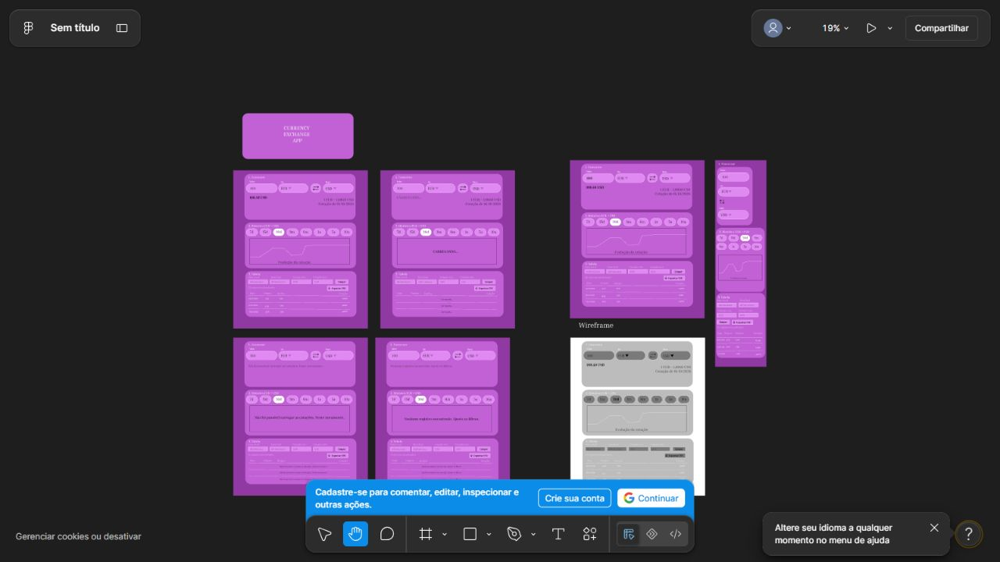

# Protótipos no Figma

[Abrir o Figma](https://www.figma.com/design/r8NQLtIt4OJN4LrsHzV0Vz/).

Revisão visual em 25/10/2026: link aberto sem autenticação. O arquivo se chama
“Sem título”, mas contém os artefatos do projeto.

- À esquerda: desktop normal, carregando, erro e ausência de dados.
- À direita: proposta desktop colorida, wireframe em tons de cinza e versão mobile.
- Os quadros coloridos representam o protótipo de média fidelidade.

Esta revisão confirma as telas; não afirma que exista navegação interativa entre elas.

## Relação com a implementação

A aplicação preserva a paleta roxa e as três seções: conversor, histórico e tabela.
Durante a implementação foram acrescentados cabeçalho, introdução, validação,
paginação e foco de teclado. O protótipo orienta a estrutura; não é uma cópia
pixel a pixel da interface final.

[Captura completa mobile](images/app-mobile.png).
